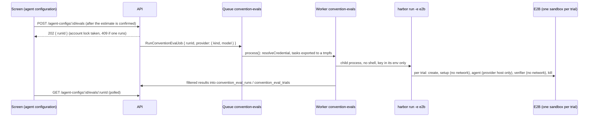

# Decision record: evals of the agent conventions

Status: accepted for the task format, the graders, the conditions and the metric (sections 3,
10, 11, 12); accepted by the owner's decisions of 2026-11-27 for the path of a test (trials in
E2B sandboxes driven by Harbor, launched from the app, paid with the user's saved key, behind the
`convention-evals` flag, opened only after an admin pilot), and for the subscriptions (option A of
section 8) and the pilot's budget (a $5 cap per run, section 9). **Open, the owner decides**: the
text of the AGENTS.md rule (section 5), a separate E2B team or key before opening (sections 13
and 15), a larger disk on the install only if a template does not fit (section 13), and the
written acceptance of the install's log collector for the pilot if the 192.0.2.1 canary lands
(section 13). Date: 2026-11-27. Follows issue #140; issue #142, PR #143.

## 1. Context

`e2e/generated-files.test.ts` proves that what `renderAgentContext` writes is well formed. Nothing
measures whether a coding agent that reads those files follows the ready-made rules. This suite
measures that, for the rules a program can grade on the final state of a repository. It serves two
readers: the catalog (what it finds changes the rules' lines, the gates or `APPLIED_RULES`) and,
behind `convention-evals`, the owner of an agent configuration, who runs a short test of their own
rendered files from the app with their own saved key.

## 2. Where it lives

`packages/catalog/evals/`, in the package that renders what it measures:

- `src/task.ts`: the format (`EvalTask`, `Condition`, `Polarity`, `Verdict`).
- `src/workspace.ts`: one fresh repository per trial, its conventions rendered at that moment.
- `src/graders.ts`: the readers and checks of a final state (manifest, lockfiles, history).
- `src/git.ts`: Git with none of the machine's configuration.
- `src/versions.ts`: Harbor's and the agents' CLI versions; `versions.test.ts` keeps every copy equal.
- `tasks/`: the tasks, their fixtures, their reference and violating solutions.
- `tasks.test.ts`: the offline checks run by `pnpm --filter @coreloom-uml/catalog test`.

The rendered files exist only in a trial's repository, never in this one: no fixture holds a
generated file. What runs the trials moves to a worker of the API (sections 4 and 14).

## 3. Task format

A task is one TypeScript object (`EvalTask`):

- `rule`: the ready-made rule graded (slot and rule id, checked with `acceptedProblem`);
  `context`: other rules held and not graded.
- `polarity`: `applies` (the task makes the rule matter), `idle` (it does not, and acting on the
  rule is a change nobody asked for) or `flip` (the other rule of the slot, against the usual
  habit). Every graded slot has an `applies` task and an `idle` or `flip` one.
- `instruction`: what a user who says nothing of the conventions would ask.
- `files`: a neutral fixture (no lockfile, no `packageManager`, one `Initial commit`) committed once
  on `main` and pushed to a bare `origin`.
- `success` and `compliance`: two graders of the final state. `compliance` answers `pass`, `fail`
  or `not-applicable`. A task is written so that `success` passing implies `compliance` applies: a
  refusal to work never counts as following the rule.
- Solutions written by hand, graded offline in CI for every task: `reference` and `alternatives`
  (both graders pass), `violations` (`success` passes, `compliance` fails), `incomplete` (`success`
  does not pass), `untouched` (the verdict on the fixture as it is). The grader tests are checked
  by mutation: 44 of 47 mutants are killed, the 3 others are equivalent.

Graders read the outcome, never the path or the transcript: the files, the diff against the base
commit, the manifest and the lockfiles; the commits of every branch, of every remote's
remote-tracking branches, of `HEAD` and of the bare `origin`, merges included, each subject read
as the rendered `commit-msg` hook reads it (`CONVENTIONAL_SUBJECT_PATTERN`,
`EXEMPT_SUBJECT_PREFIXES`); a hidden test run from outside the repository. Git runs with no global
or system configuration. Rules gradable only from a transcript or by a model judge are left out.

At run time each task is exported to a Harbor task folder: `instruction.md`, `task.toml`,
`environment/` (the agent's template, section 13) and `tests/test.sh` running the two graders and
writing `/logs/verifier/reward.json`. The condition's files are written at setup, not in the
Dockerfile, so there is one template per agent, not per task and condition.

## 4. The path of a test

1. **Screen.** On an agent configuration, behind `convention-evals` (`useFeature`). It lists the
   held ready-made rules that have a task, the agent the connection serves and the estimated cost
   (section 9). The button is disabled, with a message, when no held rule is testable or the
   connection cannot drive an agent. Confirming sends the request.
2. **Route.** `POST /agent-configs/:id/evals` (owner only, `assertOwner`, 404 otherwise) checks
   the flag, the connection kind and the account lock, creates a `convention_eval_runs` row
   (`queued`) and answers **202 with the run id at once**: a test lasts minutes and production
   closes a request at 100 s (Cloudflare). One run at a time per account: a Redis key of the
   account, taken by the route, expiring by itself after the job's hard limit plus a margin
   (50 min), released by the job's `finally`; 409 otherwise.
3. **Job.** `RunConventionEvalJob` on the queue `convention-evals`. Its data holds ids only. The
   key is resolved in `process()` with `resolveCredential`.
4. **Worker.** The `convention-evals` worker (section 14) exports the tasks of the run to Harbor
   task folders in a per-run tmpfs folder (0700, RAM, `noexec`), runs `harbor run -e e2b` as a
   child process started without a shell, the key in that process's environment only, with
   `HARBOR_TELEMETRY=off` and no hub upload.
5. **Trials.** One E2B sandbox per trial on our self-hosted install, with the network of each
   phase set by our environment class (section 5) and the timeouts of section 7.
6. **Graders.** `tests/test.sh` runs `success` and `compliance` and writes the reward.
7. **Storage.** The worker reads Harbor's job folder from the tmpfs, filters every output
   (section 5), and stores per trial: grades, verdicts, counts, durations, token usage and cost,
   and the filtered, capped agent output. The folder is removed in a `finally`.
8. **Results.** The screen polls `GET /agent-configs/:id/evals/:runId` (TanStack Query
   `refetchInterval`) until the run is `done`, `failed`, `cancelled` (cap reached) or `leaked`.

### As built (#148)

- **Routes** (`app/convention-evals/`, behind `convention-evals` and `E2B_API_KEY`, 404 without
  either, the owner only): `GET /agent-configs/:id/evals/plan?kind=&model=` answers what a test
  would run (the held rules that have a task, the tasks, the path and its label, the trial count,
  the estimate [p50, p90] with `pricesCheckedOn`, the cap) and `refusal`, null or one of
  `no_testable_rule`, `no_credential` (a key kind with no saved key, a subscription not
  connected), `provider_settings`, `over_cap` (the lower estimate passes the cap); a subscription
  kind behind its off flag is a 404. `POST /agent-configs/:id/evals` takes the provider as every
  other model feature sends it (`{ provider: { kind, model } }`; a saved key's base URL comes from
  its row), plans again, answers 422 with the refusal, 409 when the account lock is taken, else
  creates the run `queued` and answers 202 `{ runId }`. `GET /agent-configs/:id/evals` is the
  paginated list, `GET …/:runId` the run and its trials.
- **Job data**: `{ runId, provider: { kind, model } }`, no id of anything else and no credential
  (a spec reads the dispatched payload). Never retried.
- **Path per kind**: `anthropic` key → path I with Claude Code, `openai` key → path I with Codex;
  every other kind → path II (section 8). The run stores `path`, `agent` and the label.
- **Grading moved into sandboxes.** The graders run Git on the agent's repository (its
  `.git/config` can name a `core.fsmonitor` or a filter, which Git then runs) and the hidden test
  on the agent's code: on the worker, either would run a stranger's code beside the E2B key, the
  database and the encryption keys. So a trial is graded in a sandbox (`GRADE`, as root, after
  `kill -1` as the agent's user and a `chown` to root), from the catalog's TypeScript source and
  zod (`grade-cli.ts`, `grader-bundle.ts`). Path II grades in the trial's own sandbox; path I in a
  fresh sandbox of the harness template holding the final state Harbor copied back (the contract's
  `state`), cut off the network. The contract with #147 is unchanged; #147's own verifier may run
  the same `grade-cli.ts`.
- **Filter** (`output-filter.ts`): `SECRET_PATTERNS` (Anthropic, OpenAI, E2B, GitHub tokens, JWTs)
  plus, on path I, the key's value, URL-encoded, hex (both cases) and base64 / base64url at each of
  the three alignments. Applied to every output, every Harbor error name and every grader reason. A
  match: that trial is stored `leaked` with no output and no reason, nothing else is stored, the
  run ends `leaked`.
- **Harbor** is reached through `HarborRunner` (container class, swapped in tests): the module
  `@coreloom-uml/catalog/evals/harbor` is loaded at run time, the child started without a shell,
  `detached` (its own process group, killed with `SIGTERM` then `SIGKILL` after 10 s), its
  environment exactly the one `prepareHarborRun` returns plus the key under `credentialEnvName`.
  Its job folder is read every 30 s for the cost so far. After the run, whatever E2B lists with
  `coreloom.run=<id>` is killed; a run Harbor answers no result for fails `runner_failed`.

## 5. Credentials

The owner decided that the real key enters the sandbox, with an exception written in AGENTS.md,
the proxy being rejected. The rule below is a proposal.

### Proposed AGENTS.md rule (the owner validates it)

> - **Convention tests: `app/convention-evals/`, the one place a saved key enters a sandbox.**
>   Behind the `convention-evals` flag (404 while off), the owner of an agent configuration runs
>   its rendered files against a coding agent's CLI in E2B sandboxes (`POST
>   /agent-configs/:id/evals`, 202 with a run id; `GET /agent-configs/:id/evals/:runId`). That CLI
>   calls the model itself, so for this feature only, and for saved API keys of kinds `anthropic`
>   and `openai` only (never a subscription, a key of another kind, or any other secret), the key
>   enters exactly one E2B sandbox per trial, for that trial's agent command. `RunConventionEvalJob`
>   (queue `convention-evals`, its data ids only) resolves it in `process()` through
>   `resolveCredential` and hands it to Harbor, a child process started without a shell, as an
>   environment variable of that process only. Harbor passes it on only as an environment variable
>   of the agent's own command (`exec(env=)`), never as a startup env of the sandbox, `--ae K=V`,
>   `--ee`, a value in `task.toml`, a file (in the sandbox or anywhere else), an argument, a
>   template build or a job's data; our Harbor environment class drops key names from the startup
>   envs and a test fails if a task or a command line names one. Codex runs through an agent class
>   of ours that passes `CODEX_API_KEY` per command and writes no `auth.json`. The agent's command
>   runs as a user other than root (the task's `[agent] user`). Harbor's job folder is a per-run
>   tmpfs (0700, on a worker with no swap), removed in a `finally`. What the agent itself prints or
>   writes stays in the sandbox and that tmpfs until it is filtered. Every transcript, trajectory,
>   verifier output, log and error is filtered in memory, before anything is stored or logged, for
>   the key's exact value, its base64, base64url, hex and URL-encoded forms, and `SECRET_PATTERNS`;
>   a Harbor or provider error is reduced to a `LlmFailureReason` first. A trial with a match is
>   stored as `leaked` with no output at all, the run stops, and the owner is told to rotate the
>   key. Rows hold grades, counts, durations, token usage and the filtered, capped output. During
>   the agent phase the sandbox reaches the provider's API host only (`allow_out` that host,
>   `deny_out` all other traffic, `RESEARCH_DENIED_RANGES`, `169.254.0.0/16` and `192.0.2.0/24`),
>   the final policy asserted before the agent starts; setup and the verifier get no network. The
>   sandbox is killed in a `finally`, E2B's timeout ends it otherwise, and
>   `PruneConventionEvalSandboxesJob` kills any that E2B still lists with
>   `coreloom.purpose=convention-evals` or any `harbor.job_id`, running or paused. Only the
>   `convention-evals` worker runs Harbor. The screen says, before confirming, that the key enters
>   a sandbox and recommends a key with a spending cap. Every other rule about keys still holds: a
>   key is never returned, logged, traced, or put in a job's data, Redis, a row or a file on a disk
>   of ours.

`SECRET_PATTERNS` does not exist yet: it is the list of key shapes (Anthropic, OpenAI, E2B, GitHub
tokens) the filter looks for beside the exact value, written with the filter (ticket 4).

Other AGENTS.md sentences that change with it:
- The general key rule ("never returned, logged, traced or put in an error, a job's data, Redis
  or a sandbox") ends with "or a sandbox (but the convention tests, below)", so the two rules do
  not contradict.
- "`ResearchSandbox` … with `RepositorySandbox` …, the only files that import `e2b`" also names
  the file of `PruneConventionEvalSandboxesJob` (JS `e2b`) and Harbor in the `convention-evals`
  worker (Python `e2b`).
- "Nothing of a credential is kept on a disk" holds only with a worker with no swap: the tmpfs and
  the partial redaction Harbor may write in `config.json` (fix b) both go with the tmpfs.

### Where Harbor 0.27.0 would break it, and what we do

| | What Harbor does (code read, live checks 4 and 5) | What we do |
|---|---|---|
| a | `_startup_env` is the task env plus `--ee`: a key there becomes a startup env of the sandbox. Agent credentials (`agent.extra_env`) go per command. | Key through the agent's env only. An environment subclass drops key names from `_startup_env` (Harbor's `superserve.py` does the same). A test of the exporter fails if `task.toml` or the command line names a key variable. |
| b | Its `config.json` files serialise env through `templatize_sensitive_env`: `${KEY}` when the value equals its own `os.environ` (check 4: the fake value was in no file of the job folder), else a partial redaction (first 4 and last 3 characters). | The key is in Harbor's process env only, never a literal value. The filter reads the written JSON too. |
| c | The built-in Codex agent writes `$CODEX_HOME/auth.json` holding `OPENAI_API_KEY` (check 5). | An agent subclass running `codex exec` with `CODEX_API_KEY` per command, no auth file; a test lists `$CODEX_HOME` after a trial. |
| d | The job folder holds `trial.log`, `job.log`, the agent's output, sessions, trajectories and the verifier's output, written before we can filter. | Per-run tmpfs, filtered from there, removed in a `finally`; stale folders purged at worker start. |
| e | `add_inference_hosts` adds the agent's inference host by itself; a task's allowlist can widen egress. | The environment subclass asserts the final policy equals `[provider host]` before the agent phase, else the trial fails. |
| f | Only `harbor.job_id` and `harbor.trial_name` as metadata; `stop()` treats a failed kill as a warning. | The subclass adds `coreloom.purpose=convention-evals` and `coreloom.account=<id>`; after the run the worker kills whatever E2B still lists with the run's `harbor.job_id`; the sweep of section 7 catches the rest. |

Not observed yet: whether the key persists inside the sandbox after the agent phase (check 4
stopped at an authentication error, so no verifier ran). A pilot task asking the agent to print
its environment and to write it to a file must end `leaked` (section 15).

## 6. Network

- Setup and verifier: no network (the CLIs are in the template).
- Agent phase: `allow_out: [api.anthropic.com]` or `[api.openai.com]`, `deny_out` all traffic,
  `RESEARCH_DENIED_RANGES`, `169.254.0.0/16` and `192.0.2.0/24`. No npm registry: the tasks need
  no install from the network (what pnpm needs is in the template; a task that needs more is not
  added).
- The agent's command runs as a user other than root (`[agent] user` in the exported
  `task.toml`): root reads every process's `/proc/*/environ`, envd's included.
- `CLAUDE_CODE_DISABLE_NONESSENTIAL_TRAFFIC=1` for Claude Code.
- Live check 2: a non-allowed host is refused by SNI (TLS reset), private ranges time out. The
  residuals are in section 13.

## 7. Cleanup

Durations (settled 2026-11-27):

| What | Value |
|---|---|
| `sandbox_timeout_sec` | 300, renewed every 60 s while the trial runs: an orphan dies at most 5 min after renewal stops |
| Agent timeout per trial | 600 s |
| Verifier timeout | 120 s |
| Job | 45 min, hard (the job kills Harbor's process group, then the run's sandboxes) |
| `PruneConventionEvalSandboxesJob` | every 10 min: kills every sandbox, running or paused, that E2B lists with `coreloom.purpose=convention-evals` or any `harbor.job_id` and that is older than 50 min, driven by E2B's list, not by rows (so it still catches a sandbox if our metadata subclass failed) |
| Tmpfs job folder | removed in the job's `finally`; stale ones purged when the worker starts |

The sweep is scheduled by the setup command that schedules the other periodic jobs. The daily,
row-driven `PruneAssistantSandboxesJob` is not reused: it is far too slow for a key, and a sandbox
Harbor created has no row of ours.

What proves deletion: `kill()` returns (false: already gone); after the run, E2B's list filtered on
the run's `harbor.job_id`, running and paused, is empty (check 6: empty after 5 runs); a `connect`
answers 404; an orphan dies by E2B's timeout on the self-hosted install (check 6: a runner killed
with SIGKILL, timeout 60 s, renewal 20 s: still running at 45 s, gone at 81 s). Harbor never
pauses a sandbox, so no memory or disk snapshot is kept; to check once on the install.

What remains nowhere: no job folder (tmpfs, removed); nothing in Redis beyond ids (the job's data)
and the account lock; nothing in rows beyond the filtered results; the `harbor-<hash>` templates
hold no secret (no build argument or file names a key, a lint test of the exporter checks it).

## 8. Subscriptions

**Decided: option A** (owner, 2026-11-27), under the app-wide rule "a model call made for a user
goes through the provider configured in that user's settings": saved `anthropic` and `openai`
keys go through (I), every other kind (`claude-code`, `openai-codex`, `mistral`, `ollama`,
`openai-compatible`) through (II). Built in #148; the comparison below is kept for the record.

### Path II as built (#148)

- **Loop**: `runCodingTrial` (`packages/llm/src/coding-trial.ts`) runs in the worker with the
  user's model (`userLanguageModel`, so `resolveCredential` for every call): one tool, `run` (one
  bash command, 4,000 characters at most, its output cut to 8,000 for the model), at most 30
  steps, 600 s, temperature 0, no retry. It never throws: a provider failure ends the trial with
  its reason and the repository is graded as it is. Usage is counted after each step
  (`onStepEnd`, by price class: plain input, cache reads, cache writes, output), so the cap is
  checked while a trial runs. `claude-code` uses the one-action mode of `createClaudeCodeModel`
  (each step one launch under `withClaudeLock`) and runs one trial at a time (`SERIAL_KINDS`);
  others three at once.
- **`full`**: the configuration's files rendered now (`render` on `currentInputs`, its own
  targets), written in the workspace with the hooks turned on, and its AGENTS.md given in the
  system prompt inside `<agents-md path="AGENTS.md">`, as a tool gives its own instruction file.
  **`none`**: no file, no block. For path I the agent's own target (Claude Code or Codex) is added
  to the targets rendered, so the CLI finds its pointer and settings.
- **Sandbox** (`EvalSandboxes`, `app/convention-evals/services/eval-sandbox.ts`): template
  `coreloom-uml-convention-evals-r1` built by `node ace assistant:setup` from the install's `base`
  plus Node 26.3.0 (tarball checked by its SHA-256), pnpm 11.5.2, a Git identity and slugify 1.6.6
  in pnpm's store and metadata cache (`prefer-offline`), since a trial has no network.
  `denyOut: [ALL_TRAFFIC, RESEARCH_DENIED_RANGES]` at creation and again through `updateNetwork`
  before anything runs (a sandbox E2B does not confirm is not used), metadata
  `coreloom.purpose=convention-evals`, `coreloom.run`, `coreloom.account`, timeout 300 s renewed
  every 60 s, killed in a `finally`. No environment variable of ours; the only files are the
  workspace (built on the worker by `createWorkspace` from our fixture, one tarball, `SETUP`
  re-points `origin`) and, after the loop, the graders.
- **Commands**: the fixed lines of `eval-commands.ts`; the model's command is the variable
  `SHELL_COMMAND` of `SHELL` (from the repository's root, `timeout -k 2 120`, output capped at
  20,000 bytes in the sandbox). Tested with this machine's bash.
- **Grading**: in the same sandbox, as root (section 4, "As built").
- **Label**: "your model + your conventions", never mixed with a CLI's results.

### `openai-codex`: fixed, not yet checked live

The SDK sent the earlier items of a tool loop as `item_reference`s, which the Codex endpoint
cannot resolve since `codexFetch` forces `store: false`. `createCodexModel` now gives the SDK
`store: false` itself (a `transformParams` middleware), so the SDK sends each earlier item inline
(the `function_call`, its `function_call_output`, a reasoning item with its `encrypted_content`)
and adds `include: ["reasoning.encrypted_content"]`. `codex.test.ts` checks the second request of
a two-step tool loop against a fake endpoint: no `item_reference`, the three items inline. It has
not been sent to the real endpoint (no call with a real credential in this build): the pilot, or
one manual call, confirms it. Until then the convention tests accept `openai-codex` on path II and
the screen should call it unverified; the other features that refuse it (web research, the
assistant's actions and readings, the exploration before a drawing) are unchanged.

### The comparison that led to A

The owner requires subscriptions to be usable for tests as for the assistant. Two architectures:

| | (I) The agent's CLI in the sandbox | (II) Our loop in the API, the sandbox runs commands |
|---|---|---|
| Kinds covered | `anthropic` (Claude Code), `openai` (Codex); `openai-codex` only with an access token alone; `claude-code` only by copying `claude_code_states` or a new `claude setup-token` credential; `openai-compatible` only for a public endpoint speaking the tool's API; never `mistral`, `ollama` | Every kind, through `resolveCredential`; `claude-code` in its one-action mode (one launch a step, under the owner's lock, so serial); `openai-codex` after a fix (below) |
| Risk | Copied subscription files: the CLI rotates the refresh token and the sealed row keeps one already spent (disconnects the subscription); `withClaudeLock` (180 s) held for minutes, blocking the assistant; a long-lived refresh token readable by a permission-bypassing agent, with no spending cap; a file on the worker for Codex | No credential enters the sandbox; residuals: injection from fixtures steering tool calls (contained by `isolate`, no secret), cost per step, contention on the Claude lock |
| Validity | Full: the real tool reads AGENTS.md, CLAUDE.md, its settings and hooks | "Model + our harness": CLAUDE.md, the tools' settings, permissions and their own hooks do nothing; `none` keeps its meaning, `full` reduces to our AGENTS.md injection plus Git hooks |
| Effort | Keys: the path of sections 4 to 7; `openai-codex` +1.5 d; `claude-code` file copy +2 d (refused) | 5 to 7 d, plus 1 to 2 d for `openai-codex` |
| Refused kinds | "Convention tests run Claude Code or Codex with your connection. A Mistral connection cannot drive either. Connect an Anthropic or OpenAI key." For Ollama: "Your Ollama server is on a private network the test sandbox cannot reach." | None by kind |

`openai-codex` under (II): today it cannot carry a tool call from one step to the next (422 in
research), because the endpoint is called with `store: false`. Two ways: send the earlier items
inline with `include: ["reasoning.encrypted_content"]` (1 to 2 d, to verify), or reuse the
one-action JSON adapter of `createClaudeCodeModel` (about 1 d).

What is left for Harbor under (II): the task and verifier format only. A Harbor agent driving
`environment.exec` from outside would need its model calls routed into the API, which is the
rejected proxy; so the API drives E2B itself with the JS `e2b` SDK (`RepositorySandbox`'s way),
reading the exported task folders.

Options, **decided: A** (see the top of this section):

- **A. Keys through (I), subscriptions through (II)**, results labelled "model + your conventions
  through Coreloom's harness" and never mixed with a CLI's. Recommended: it meets the requirement
  within the existing rules. (I) would spend the refresh tokens the sealed rows keep, need
  `withClaudeLock` held for minutes, and put a long-lived token in a permission-bypassing sandbox.
  The exception stays as drafted (saved keys only).
- **B. (I) for `openai-codex` with an access token only**: the API refreshes the tokens under a
  lock and writes no refresh token into the sandbox; the access token's lifetime is to be
  measured, and the provider's terms for automated runs checked. The exception widens to "a
  short-lived ChatGPT access token, never a refresh token", with a lock and a written-file rule for
  Codex's `auth.json`. `claude-code` stays out or goes through (II).
- **C. A new credential kind from `claude setup-token`, run through (I)**: a new stored secret
  (sealed by `llmKeys`, bound to its owner), new rules, Anthropic's terms for automated runs to
  check, a token that lives long and is hard to revoke. The exception widens to that kind.
- **D. Subscriptions left out**: the button is disabled for them with a message. The exception
  stays as drafted; the requirement is not met.

## 9. Short default test and its cost

- Agent: one, the one the connection serves (`anthropic`: Claude Code; `openai`: Codex).
- Rules: the held ready-made rules that have a task. Today `git.commit-messages` (`conventional`:
  `applies`; `imperative`: `flip`) and `tooling.package-manager` (`pnpm`: `applies` and `idle`).
  None held: the button is disabled with "None of your rules can be tested yet. Testable now:
  commit messages, pnpm."
- Conditions: `none` against `full` (their rendered files).
- k = 3. Trials = tasks (1 to 3) × 2 × 3: 6 to 18, at most 18. Three trials at once.
- Wall clock: one trial 2 to 4 min (p95 about 6); 18 trials 15 to 25 min, plus up to 8 min the
  first time a template is built.

Cost per trial, from estimated tokens (the tasks are tiny: fixture about 300 tokens, instruction
about 40, rendered AGENTS.md 1 to 3k, 8 to 12 turns) and the prices checked on 2026-11-27:
Claude Sonnet 5.5 $2 input, $2.50 5-minute cache write, $0.10 cache hit, $10 output per MTok;
GPT-5-Codex $1.25 input, $0.125 cached, $10 output per MTok.

| Agent | Tokens per trial (estimate) | Per trial | 18 trials (p50) | p90 (2.5×, unmeasured) | No cache at all, 18 trials |
|---|---|---|---|---|---|
| Claude Code | 220k input (198k cache hits, 22k cache writes), 3k output | 0.0198 + 0.055 + 0.030 = $0.105 | $1.9 | $4.7 | 18 × (220k × $2 + 3k × $10) = $8.5 |
| Codex | 150k input (120k cached, 30k uncached), 5k output with reasoning | 0.015 + 0.0375 + 0.050 = $0.10 | $1.8 | $4.6 | 18 × (150k × $1.25 + 5k × $10) = $4.3 |

The screen shows a range [p50, p90] computed from a price table in code (`as const`, with the date
its prices were checked) and the per-trial token figures: Σ over tasks of k × conditions × Σ over
token types (tokens × price). Beside it, a hard cap per test, set by the admin (default $5 for
users; the pilot's cap is the budget the owner approves; the default is revised from the pilot's
measured p90, ticket 8): after
each trial the worker adds its measured cost, and when the next wave could cross the cap it
cancels the remaining trials and reports partial results (`cancelled`). The worst overshoot is
concurrency × one trial's p99. Per trial, `--max-turns` for Claude Code and the agent timeout for
both bound the spend.

### Prices and cap as built (#148)

The price table is `EVAL_PRICES` (`app/convention-evals/constants/eval-prices.ts`), checked on
**2026-11-27** (`EVAL_PRICES_CHECKED_ON`) on the three providers' pricing pages
(`EVAL_PRICE_SOURCES`), standard tier, US dollars per million tokens (input / output / cache read
/ cache write):

| Provider | Model | Input | Output | Cache read | Cache write |
|---|---|---|---|---|---|
| Anthropic (5-min writes) | claude-fable-5-1 | 10 | 50 | 0.25 | 12.50 |
| | claude-fable-5-2 | 8 | 40 | 0.20 | 10 |
| | claude-opus-5 | 5 | 25 | 0.50 | 6.25 |
| | claude-opus-5-5 | 4 | 20 | 0.20 | 5 |
| | claude-sonnet-5-5 | 2 | 10 | 0.10 | 2.50 |
| | claude-sonnet-5 | 2 | 10 | 0.20 | 2.50 |
| | claude-haiku-5-5 (rate over 100k-token prompts) | 0.50 | 2.50 | 0.05 | 0.625 |
| OpenAI (30-min writes) | gpt-6-astra | 10 | 50 | 1 | 12.50 |
| | gpt-6.2-astra | 8 | 40 | 0.40 | 10 |
| | gpt-6.2-sol, gpt-6.1-sol | 2 | 10 | 0.10 | 2.50 |
| Mistral (no cache-write price: as input) | zai-glm-5-3 | 1.40 | 4.40 | 0.14 | 1.40 |
| | mistral-large-4 | 0.70 | 2.10 | 0.07 | 0.70 |
| | codestral-2508 | 0.30 | 0.90 | 0.30 | 0.30 |
| | deepseek-v4-1-flash-1017 | 0.30 | 1.20 | 0.007 | 0.30 |
| | mistral-small-2603, zai-glm-5-3-flash, ministral-* | 0.10 to 0.20 | 0.10 to 0.60 | | |

GPT-5-Codex, which the estimate above used, is no longer on OpenAI's list; the Codex figures stay
as token estimates, priced with the table. A subscription is priced as its provider's key would
be (`claude-code` aliases `sonnet`, `opus`, `haiku`, `fable` read as the 5.5 / 5.2 models;
`openai-codex` with the OpenAI table), an equivalent cost. A model not listed is priced as its
provider's most expensive listed one (CTO arbitration). `ollama` and `openai-compatible` have no
table: their runs are capped in tokens (`maxTokens`, 6 million) instead of dollars, and the plan's
estimate is null.

Per-trial tokens (`EVAL_TRIAL_TOKENS`, estimates until the pilot): Claude Code and Codex as in the
table above; our harness 60k uncached input and 3k output (a short system prompt, no cache
breakpoint, about ten steps). The upper bound is 2.5 times the lower. The plan refuses a run whose
lower estimate passes the cap (`over_cap`).

The cap (`CONVENTION_EVAL_LIMITS.capUsd`, $5) is enforced by `RunLedger`: on path II, no trial
starts when what was measured plus (trials under way + 1) times one trial's upper estimate could
pass it, and every step's measured usage is counted at once, so a trial under way is aborted as
soon as the spend passes it; on path I, Harbor's job folder is read every 30 s and its process
group killed when what finished plus a wave of three at the upper estimate could pass it. Either
way the run ends `cancelled` with `cap_reached` and keeps the trials done. Hard limits: 45 min on
path I, 90 min on path II (`cancelled`, `time_limit`).

The pilot measures, per agent and task: median and p90 of uncached input, cache write, cache read
and output tokens, and the turns (Claude Code's `stream-json` `usage`, `modelUsage`,
`total_cost_usd`; Codex's `--json` `turn.completed` usage; Harbor's AgentContext token fields, to
confirm on 0.27.0), cross-checked against the provider's console for the pilot key. Those figures
replace the estimates above; until then the screen exists for the admin only.

Results are shown as "held n/k" per rule and condition, `success` and `compliance` apart (a
failure of capability is not a failure of compliance), never as a "works" badge: 3 out of 3 has a
Wilson lower bound of 44 %, which cannot tell two conditions apart. The screen says that two small
tasks on one fixture say nothing of the user's own repository.

## 10. Conditions

The internal suite runs each task in three conditions, the same fixture each time:

- `none`: no convention file.
- `instructions`: AGENTS.md and the pointer each tool reads it through (CLAUDE.md). Nothing a tool
  enforces.
- `full`: every file the catalog renders for those tools (settings, rules, Git hooks), hooks on
  (`git config core.hooksPath .githooks`).

`instructions` against `none` measures what the text does; `full` against `instructions`, what the
settings and hooks add. An `idle` task that passes in `none` and fails in `instructions` means the
conventions caused a change nobody asked for. A user's test keeps `none` and `full` only.

## 11. Metric

- A trial passes when `success` and `compliance` both pass.
- Internal suite: k = 5 per agent and condition; the main figure is pass^k (the share of tasks
  whose k trials all pass). Beside it, per condition and agent: the pass rate with a 95 % Wilson
  interval, the `success` rate alone, the `compliance` rate where it applies. A difference between
  conditions is reported only with its intervals (with some 80 trials per condition and agent,
  only 15 to 20 points or more show).
- A user's test: "held n/k" (section 9).
- A run names the catalog version, the agent's CLI version, the model and Harbor's version; two
  runs are compared only when they differ in one of these.

## 12. Clean trials and traces

- Every trial starts from a new sandbox and a new repository built by `createWorkspace` with fixed
  dates; nothing of an earlier trial remains.
- Hidden tests are written outside the repository and never shown to the agent.
- Transcripts and the verifier's output live only in the run's tmpfs until filtered. What is kept
  is the filtered, capped output in the trial's row; nothing is committed.
- Every failure, and a sample of passes, is read before a score is trusted. For the pilot every
  transcript is read.
- Never in CI: no test calls a provider. The internal lot runs through the same path, from the
  admin's account, when a `CATALOG_VERSION` touching a rule of the lot, a pinned CLI or a default
  model changes.

## 13. Harbor with our self-hosted E2B

What works (live checks of 2026-11-27, no model call):
- Harbor 0.27.0 `-e e2b` reaches the self-hosted install through `E2B_API_URL` and
  `E2B_SANDBOX_URL` with no patch: template built, oracle trial passed, reward 1.0, 1 min 3 s with
  the build (check 1).
- The allowlist holds: the provider host reached, others refused by SNI, private ranges refused;
  the agent command's environment holds no variable of ours (check 2).
- The built-in Claude Code agent with a fake key: the version pinned by `--ak version=` reused,
  the provider answered 401, the value in no file of the job folder (check 4).
- Sandboxes are gone after runs, and an orphan dies by its timeout (check 6).

What does not: disk (check 3). The install keeps about 931 MB of root disk per sandbox; a template
with Claude Code, curl, git and procps did not build ("No space left on device"), Claude Code alone
on node slim did. So one small template per agent (Node slim, git, pnpm, that agent's CLI), built
from the `agent` stage; whether Codex's template fits is unchecked (ticket 2). The other way is a
larger disk on the install, an operational change of the vendored `infra/e2b/` (open: the owner
decides, only if a template does not fit).

Residuals, and what ticket 7 must prove for each:
- **MMDS** (169.254.169.254, Firecracker's metadata service) answers despite deny-all; with a
  token it gives a hash, the envd log address, the env and instance ids, not a token. Not a
  blocker. Prove that it still answers with `169.254.0.0/16` denied (it is served inside
  Firecracker, not routed), that no path returns a token or another sandbox's data, and that a
  write from inside the sandbox is refused.
- **The install's log collector** (`http://192.0.2.1/logs`) is reachable whatever the policy.
  **A pilot blocker.** Send a POST in envd's own format with a canary value and record whether it
  reaches `e2b-vector-1` or any other sink. If it lands, the key could be written into the
  install's logs, which breaks "never logged": either that ingestion is turned off for these
  sandboxes, or the owner accepts it in writing for the pilot only and the install's logs are
  scanned for the pilot key afterwards. Before opening, a real fix.
- **DNS**: recorded before the pilot, a blocker before opening. Record the resolver of
  `/etc/resolv.conf`; check whether `dig @1.1.1.1`, DoH and DoT are refused; look up a unique name
  under a domain we own and read its authoritative query log. If names that are not allowed are
  forwarded upstream, DNS is an open way out: before opening, a resolver that answers the allowed
  host only, or a written acceptance by the owner.
- **Domain fronting**, not a blocker: send TLS with SNI `api.anthropic.com` and a `Host:` of
  another domain, and record that the provider's edge refuses it. The output filter and a capped
  key are what holds otherwise.
- **The shared E2B key**: the worker holds the install's E2B key, which drives every sandbox of
  the install, the assistant's and the research's included. Not a blocker for the pilot (our
  worker, the admin's run); a blocker before opening: a separate E2B team or key, or the owner's
  written acceptance (section 15).

Fallback if Harbor's `e2b` environment stops fitting (a version that breaks a fix of section 5,
templates it cannot keep small): our own runner in the worker with the JS `e2b` SDK the API already
uses (`ResearchSandbox`, `RepositorySandbox`), Harbor's task format kept, so the exporter and the
graders stay.

## 14. What PR #143 keeps, changes and drops

- Keeps: the task format, the graders, the two task pairs, the offline tests, the version checks.
- Changes (later tickets): `requirements.in` becomes `harbor[e2b]==0.27.0` with a new lock (e2b
  2.66.0); no Docker client, Compose or daemon any more; the `agent` stage becomes the source of
  the per-agent E2B templates.
- Drops (later tickets): the standalone `evals` compose service. It becomes the worker
  `convention-evals`, a stage of `apps/api/Dockerfile` on Debian like `skill-tagger` (Harbor and
  Python 3.12 from the hash-locked lock, run as `node`), running only `queue:work
  --queues=convention-evals`, with every other worker naming its queues without it
  (`config/queue.ts`, the `queue:work` script, the `queue-worker` services).
- Done in #143: only this record and the line of `infra/evals/README.md` that pointed to the open
  questions. Everything else is in the tickets of section 16.

## 15. Security review

Top threats (security review of 2026-11-27):
1. Exfiltration through the allowed host: a convention, a skill or a fixture tells the agent to
   call the provider with an attacker's key and send the victim's key in the prompt. Only the
   owner's own text and our fixtures enter a trial, skills are left out of the first version, the
   filter runs, the key is capped and the owner advised to rotate it.
2. DNS exfiltration and domain fronting (section 13).
3. The key left in the sandbox (env read by the agent, `/proc`, a file): per-command env only, one
   sandbox per trial, kill and sweep.
4. The key in our storage: tmpfs, filter, checks on `config.json`.
5. Another account's sandbox on the same install: a microVM per trial, no shared volume, denied
   ranges, sweep by metadata.
6. The install's E2B key in the worker: a dedicated worker and image with no other secret; a
   separate E2B team or key before opening.
7. Cost abuse: one run per account, the cap per test, `--max-turns`, the model from the
   allowlist, a daily cap per account.
8. The admin pilot's key, the most valuable target: a dedicated project key with a spending cap,
   deleted after the pilot.

Before the pilot: the owner validates the rule of section 5; fixes a to f in place with tests; the
egress checked live (a non-allowed host fails, MMDS and domain fronting recorded, DNS recorded);
the 192.0.2.1 canary does not land in the install's logs, or that ingestion is off for these
sandboxes, or the owner accepts it in writing for the pilot only and the logs are scanned for the
pilot key afterwards; the agent's command runs as a user other than root; deletion proved by the
list after a run and by a sweep test; tmpfs on a worker with no swap and the filter tested with a
canary key, encoded forms included; a "print and write your environment" task ends `leaked`; the
dedicated worker; a capped pilot key.

Before opening: the pilot's transcripts read; threat 1 mitigated (no third-party text); caps and
lock live; a real fix for 192.0.2.1 if the canary landed; DNS answering the allowed host only, or
the owner's written acceptance; a separate E2B team or key, or the owner's written acceptance of
the shared one; the screen's warning about the key; a runbook for `leaked`; subscriptions as the
owner decides (section 8).

## 16. Tickets

| # | Ticket | Days | Acceptance check | AGENTS.md text by the owner |
|---|---|---|---|---|
| 1 | Worker `convention-evals`: Debian stage of `apps/api/Dockerfile`, `harbor[e2b]==0.27.0` lock, Docker client and Compose removed, `evals` service replaced by the worker service (behind a profile locally), queue in `config/queue.ts`, other workers without it | 2 to 3 | image builds; `versions.test.ts` passes in it; `harbor run -a oracle -e e2b` passes on `infra/e2b/` for every task, no key | yes: the worker rule (like the skill scanner's) |
| 2 | Per-agent templates from `agent`, and the exporter of `EvalTask` to Harbor folders (condition files at setup) | 2 to 3 | oracle passes with both templates; free disk recorded; Codex's template builds; lint test: no build argument or task env names a key | no |
| 3 | Harbor classes of ours: environment (startup envs, metadata, policy assertion, timeouts), Codex agent without `auth.json`; fixes a to f | 3 to 4 | tests with a fake key: value in no file of the job folder and in no startup env, policy equals `[provider host]`, no `auth.json` after a Codex trial | no (covered by ticket 4's rule) |
| 4 | API: flag `convention-evals`, `convention_eval_runs` / `convention_eval_trials`, the two routes, `RunConventionEvalJob` (tmpfs, child process, filter, `leaked`, `SECRET_PATTERNS`), account lock, cap | 4 to 5 | functional specs with Harbor swapped: 202, 409, 404 off flag, `leaked` on a canary, no key in the job's data, cancellation at the cap | yes: the rule of section 5 and the domain rule |
| 5 | `PruneConventionEvalSandboxesJob`, tmpfs purge at start, scheduling | 1 to 1.5 | spec with a fake E2B list; live: worker killed mid-trial, sandbox gone, list empty | no (in ticket 4's rule) |
| 6 | Screen: testable rules, agent, estimate range with its date, confirmation with the key warning, polling, "held n/k" | 2 to 3 | disabled state and message; success and compliance apart; strings in `messages.ts` (`en`, `fr`) | no |
| 7 | Live security checks (section 13): egress, MMDS with `169.254.0.0/16` denied, the 192.0.2.1 canary in envd's format (pilot blocker), DNS, domain fronting, non-root agent user, "print and write your environment" task | 1 to 1.5 | each result written in this record; the canary lands nowhere, or its ingestion is off, or the owner accepts it in writing for the pilot | no (the owner's written acceptance if the canary lands) |
| M | **Milestone: admin pilot** from the app, admin's capped key, behind the flag; waits for the owner's approval of its budget | 1 | every transcript read; token figures of section 9 measured | no |
| 8 | Prices and estimates from the pilot's figures; the users' default cap revised from the measured p90 | 0.5 to 1 | the screen's range comes from measured p50 / p90 | no |
| 9 | Subscriptions, as the owner decides (option A: runner (II) in the API, `openai-codex` fix), after the milestone. Claude-subscription runs under (II) are serial (one launch a step under the owner's lock, 30 to 45 min for 18 trials): they need a job limit of their own or a smaller format | 6 to 9 (A) | a `claude-code` and an `openai-codex` test end with results labelled as section 8 says | yes, under A, B or C |
| 10 | Before opening: separate E2B team or key, daily cap per account, `leaked` runbook | 1.5 to 2 | the conditions of section 15 met | yes if the shared E2B key is accepted instead |

Total: 18 to 25 days to opening with saved keys (tickets 1 to 8, 10 and the pilot), 24 to 34 with
subscriptions under option A.

Status after #148 (the API, built beside #147's runner):

- **Ticket 4: built.** Flag, tables, the four routes, the job, the lock, the cap, the filter and
  `SECRET_PATTERNS`, the functional specs with Harbor and E2B swapped (202; 409; 404 off the flag
  and on another account's configuration; `leaked` on a canary in an output and on the key's
  base64; no key in the job's data; cancellation at the cap; the path per kind; the refusals). One
  change to the design: grading runs in sandboxes, not on the worker (section 4, "As built").
  Left: the code against the real `@coreloom-uml/catalog/evals/harbor` once #147 lands (the
  contract types are copied in `harbor-runner.ts` until then), and AGENTS.md's text by the owner.
- **Ticket 5: built.** `PruneConventionEvalSandboxesJob` (every ten minutes, on the default queue,
  scheduled by `node ace assistant:setup`), driven by E2B's list (`coreloom.purpose` or any
  `harbor.job_id`, older than 50 min, running or paused); it also ends as `interrupted` the runs a
  dead worker left. The run folders are purged by the first run of a worker process. Left: the
  live check (a worker killed mid-trial, the list empty afterwards).
- **Ticket 9, path II: built** (section 8, "Path II as built"), including the `openai-codex` fix,
  checked against a fake endpoint only. Left: a live run with `claude-code` (the admin's
  subscription) and one with `openai-codex`, and a first build of the harness template on the
  install (its free disk recorded: Node 26 adds about 190 MB to `base`).

## 17. Superseded

The earlier sections on how the runner reaches a Docker daemon (S1 to S5) and on who pays (options
A to D: proxy, job, admin export, a credential given on the runner's machine) were superseded by
the owner's decisions of 2026-11-27: trials in E2B sandboxes, launched from the app, paid with the
user's saved key entering the sandbox under a written exception. The credential-injecting proxy
was rejected.
